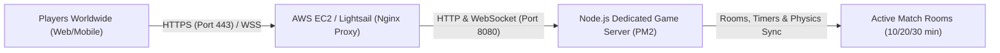

# Step-by-Step AWS Deployment Guide: Mini Militia Live Multiplayer

Deploy your **Mini Militia Web Clone** to AWS so anyone around the world can play live in real-time via their browser.

---

## Architecture Overview



---

## Method 1: AWS EC2 (Recommended - Free Tier Eligible)

### Step 1: Launch an AWS EC2 Instance
1. Open the [AWS Management Console](https://console.aws.amazon.com/ec2/).
2. Click **Launch Instance**:
   - **Name**: `mini-militia-server`
   - **OS Image**: **Ubuntu Server 24.04 LTS** (64-bit x86 or ARM)
   - **Instance Type**: `t2.micro` or `t3.micro` (Free Tier Eligible)
   - **Key Pair**: Select an existing key pair or create a new `.pem` file (e.g. `mini-militia-key.pem`).
3. **Network Settings (Security Group)**:
   Ensure the following Inbound Rules are allowed:
   - **SSH (Port 22)**: Anywhere or My IP
   - **HTTP (Port 80)**: Anywhere (`0.0.0.0/0`)
   - **HTTPS (Port 443)**: Anywhere (`0.0.0.0/0`)
   - **Custom TCP (Port 8080)**: Anywhere (`0.0.0.0/0`) *(optional if using direct port)*
4. Click **Launch Instance**. Note down the **Public IPv4 address** (e.g., `54.210.120.45`).

---

### Step 2: Connect to Your EC2 Instance
Open your terminal on your computer and connect:
```bash
chmod 400 mini-militia-key.pem
ssh -i mini-militia-key.pem ubuntu@<YOUR_EC2_PUBLIC_IP>
```

---

### Step 3: Install Node.js & Dependencies on EC2
Run the following commands inside your EC2 terminal:
```bash
# Update packages
sudo apt update && sudo apt upgrade -y

# Install Node.js 20 LTS and Git
curl -fsSL https://deb.nodesource.com/setup_20.x | sudo -E bash -
sudo apt install -y nodejs git nginx

# Install PM2 (Process Manager to keep the game server running 24/7)
sudo npm install -g pm2
```

---

### Step 4: Upload or Clone the Game Code to EC2

#### Option A: Copy files from your Mac using `scp`:
From your local terminal on Mac:
```bash
scp -i mini-militia-key.pem -r /Users/divyaraval/desktop/mini-militia-clone ubuntu@<YOUR_EC2_PUBLIC_IP>:~/mini-militia
```

#### Option B: Push to GitHub and `git clone`:
```bash
git clone https://github.com/<your-username>/mini-militia.git ~/mini-militia
```

---

### Step 5: Start the Game Server with PM2
Inside the EC2 instance:
```bash
cd ~/mini-militia

# Start server using PM2
pm2 start server.js --name "mini-militia"

# Configure PM2 to restart automatically on system reboot
pm2 startup systemd
# (Run the sudo env PATH... command that PM2 outputs)
pm2 save
```

Verify that the server is running:
```bash
pm2 status
```

---

### Step 6: Configure Nginx as a Reverse Proxy with WebSocket Support
Configure Nginx so players can access the game via standard HTTP (Port 80) without typing `:8080`:

```bash
# Copy the provided nginx configuration
sudo cp ~/mini-militia/nginx.conf /etc/nginx/sites-available/mini-militia

# Enable the site
sudo ln -s /etc/nginx/sites-available/mini-militia /etc/nginx/sites-enabled/
sudo rm -f /etc/nginx/sites-enabled/default

# Test nginx syntax and reload
sudo nginx -t
sudo systemctl restart nginx
```

Now, visit your EC2 Public IP in any browser:
```
http://<YOUR_EC2_PUBLIC_IP>
```
Your Mini Militia game is live on the internet! Anyone with the link can join!

---

### Step 7: (Optional but Recommended) Custom Domain & Free SSL Certificate
To enable secure WebSockets (`wss://`) and HTTPS:

1. In your domain registrar (GoDaddy, Namecheap, Cloudflare, Route 53), add an **A Record**:
   - `game.yourdomain.com` ➔ `<YOUR_EC2_PUBLIC_IP>`

2. Update `/etc/nginx/sites-available/mini-militia`:
   ```bash
   sudo nano /etc/nginx/sites-available/mini-militia
   ```
   Change `server_name _;` to:
   ```nginx
   server_name game.yourdomain.com;
   ```
   Save and reload:
   ```bash
   sudo systemctl reload nginx
   ```

3. Install Certbot and generate a free SSL certificate:
   ```bash
   sudo apt install -y certbot python3-certbot-nginx
   sudo certbot --nginx -d game.yourdomain.com
   ```
   Follow the prompts. Certbot automatically configures HTTPS and auto-renewal.

---

## Method 2: AWS Lightsail (The Simplest Alternative)

If you prefer a simpler interface with predictable $3.50/mo or $5/mo pricing:
1. Go to [AWS Lightsail Console](https://lightsail.aws.amazon.com/).
2. Click **Create Instance**:
   - Platform: **Linux/Unix**
   - Blueprint: **OS Only ➔ Ubuntu 22.04 or 24.04**
   - Plan: **$3.50 or $5/month**
3. Under the instance **Networking** tab, add firewall rules for **Port 80**, **Port 443**, and **Port 8080**.
4. Connect via the browser-based SSH terminal and execute Steps 3 through 6 above.

---

## Verifying Live Multiplayer
1. Open `http://<YOUR_IP_OR_DOMAIN>` in your browser.
2. Customize your Soldier Name and Camo Color.
3. Click **Create Room**, pick **10, 20, or 30 Minutes**, toggle **Unlimited Boost** on/off, and click **Deploy**.
4. Click **📋 COPY ROOM LINK** in the top bar and send it to your friends.
5. When they open the link, the Room Code is auto-filled and they can join immediately!
